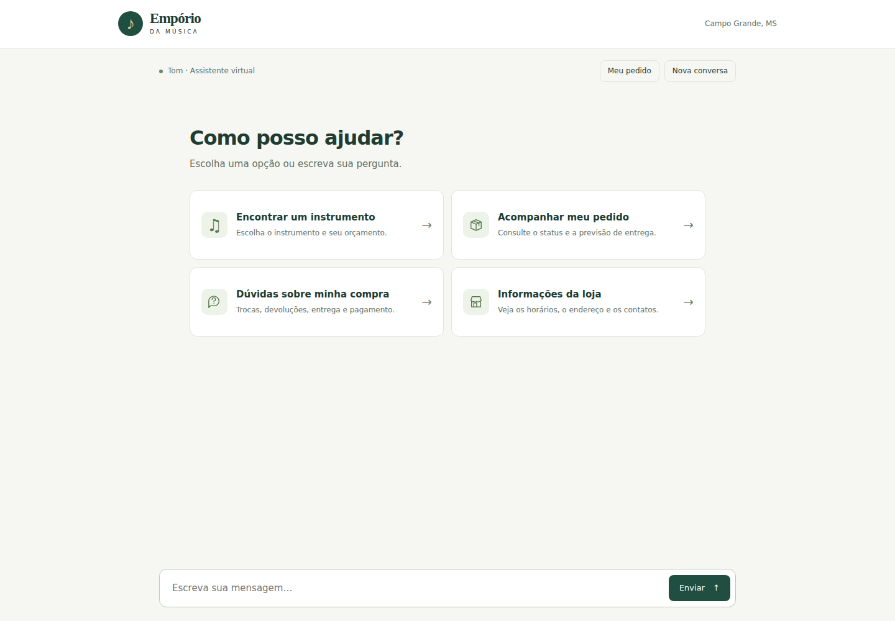
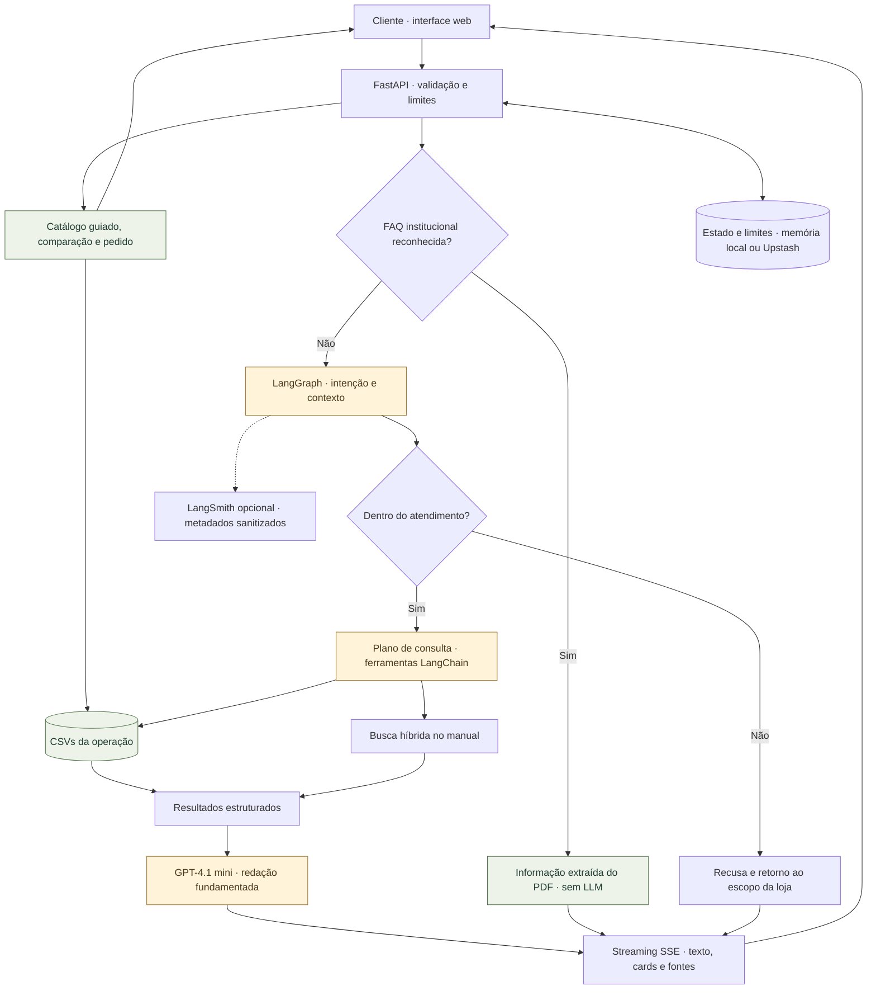
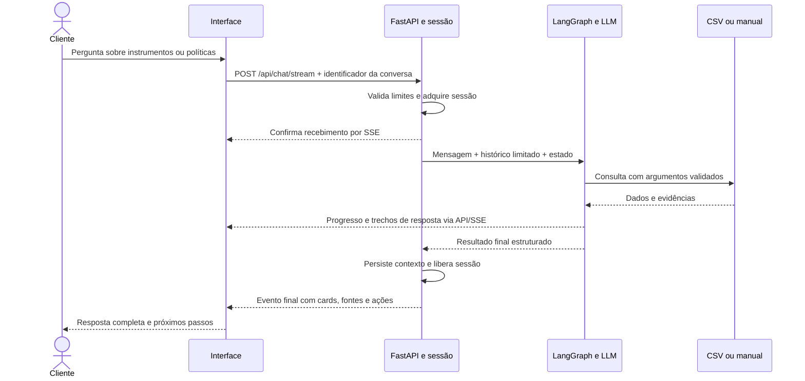
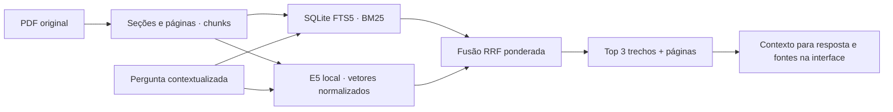

# Empório da Música · Tom

[](https://github.com/marco-kraemer/ai_eng_challenge/actions/workflows/checks.yml)

**Um atendente virtual que consulta o catálogo e o manual antes de responder.** Projeto do desafio técnico AI Engineer da Artefact: Python, LangChain, LangGraph, busca híbrida e uma interface voltada ao cliente final.

**[Abrir a demo](https://emporiomusica.vercel.app)** · [Cinco exemplos reais](docs/exemplos-de-interacao.md) · [Avaliação e custo](docs/observabilidade-e-avaliacao.md) · [Deploy](docs/deploy-vercel.md)



A loja é fictícia. Os CSVs e o manual são os dados de demonstração fornecidos no desafio. Divergências das fontes não representam condições comerciais reais.

## Acessar ou executar

| Quero… | Caminho |
|---|---|
| Testar sem instalar | [Abrir a demonstração pública](https://emporiomusica.vercel.app) |
| Rodar com minha própria chave | [Baixar e executar localmente](#executar-localmente) |
| Ler conversas completas | [Cinco conversas, incluindo tentativas de desvio](docs/exemplos-de-interacao.md) |
| Examinar decisões e resultados | [Arquitetura](#como-funciona) · [Evidências](#evidência-e-custo) |

**Disponibilidade da demo.** A demonstração hospedada utiliza crédito limitado e temporário da OpenAI para avaliação. A conversa gerada pode ficar indisponível após o esgotamento do crédito; não há compromisso de reposição contínua. Catálogo guiado, comparação, consulta de pedido e FAQ institucional dispensam chamadas ao modelo, mas continuam dependendo da disponibilidade da hospedagem e de seus serviços. A execução local é independente desse saldo e utiliza **sua própria chave e seu próprio crédito**.

## Experimente em três minutos

1. Abra **Encontrar um instrumento**, selecione Violões e Ukuleles e consulte até R$ 600. Esse fluxo consulta os CSVs sem LLM.
2. Escreva “Agora quero instrumentos de qualquer tipo até mil reais”. A LLM deve substituir o escopo anterior pelo catálogo geral.
3. Pergunte “Quero devolver uma compra por arrependimento” e depois “Comprei pela internet”. O agente pede a modalidade e consulta o manual com esse contexto.
4. Compare “Qual o endereço da loja?” com “Me ensine Python”: informação institucional vem do PDF sem LLM; programação recebe recusa.
5. Em **Meu pedido**, use número **1** e e-mail de demonstração **pedro.oliveira@jmail.com**. O formulário consulta os registros diretamente, sem enviar as credenciais ao modelo.

Mensagens recebem confirmação imediata, progresso das consultas e texto transmitido pelo provedor. Cards, fontes e estado são finalizados juntos. **Nova conversa** descarta o contexto e impede que uma resposta atrasada reapareça.

## Executar localmente

Requisitos: **Python 3.12** e internet para instalar dependências, baixar o encoder no primeiro uso do RAG e acessar a OpenAI nas conversas geradas. Git é necessário apenas para clonar. Node 22 é usado nos testes do frontend, não para abrir a aplicação.

### 1. Obter o projeto

```bash
git clone https://github.com/marco-kraemer/ai_eng_challenge.git
cd ai_eng_challenge
```

Sem Git: abra o [repositório](https://github.com/marco-kraemer/ai_eng_challenge), escolha **Code → Download ZIP**, extraia o arquivo e abra o terminal na pasta que contém `README.md` e `requirements.txt`.

### 2. Instalar e configurar

**Linux, macOS ou Windows com WSL:**

```bash
python3 -m venv .venv
.venv/bin/pip install -r requirements.txt
cp -n .env.example .env
```

**Windows com PowerShell:**

```powershell
py -3.12 -m venv .venv
.venv\Scripts\python.exe -m pip install -r requirements.txt
Copy-Item .env.example .env
```

Copie o arquivo de exemplo somente na primeira configuração, para preservar um `.env` já preenchido. Preencha o `.env` local com **sua chave**, sem versioná-lo:

```dotenv
LLM_PROVIDER=openai
OPEN_AI_KEY=sua-chave
OPENAI_MODEL=gpt-4.1-mini
```

### 3. Iniciar o atendimento

**Linux, macOS ou WSL:**

```bash
.venv/bin/uvicorn app.web:app --host 127.0.0.1 --port 8000 --workers 1 --no-proxy-headers
```

**PowerShell:**

```powershell
.venv\Scripts\python.exe -m uvicorn app.web:app --host 127.0.0.1 --port 8000 --workers 1 --no-proxy-headers
```

Mantenha o terminal aberto e acesse **http://localhost:8000** no navegador. Use `Ctrl+C` para encerrar o servidor. `OPENAI_API_KEY` também é aceita; `OPEN_AI_KEY` tem prioridade. Sem chave/cota, catálogo guiado, comparação, pedido e FAQ institucional continuam disponíveis. A conversa gerada precisa do provedor.

Upstash é opcional localmente e obrigatório na Vercel. LangSmith é opcional: configure `LANGSMITH_API_KEY` e `LANGSMITH_PROJECT=emporio-musica`. Os segredos ficam exclusivamente no servidor. Todas as variáveis estão em [.env.example](.env.example).

## Como funciona

A aplicação usa dois caminhos: consultas guiadas executam regras determinísticas; mensagens livres passam pelo agente quando precisam de interpretação. O backend mantém os dados e as credenciais fora do navegador.



O pedido usa número + e-mail em um formulário próprio e não passa pela LLM. Em mensagens livres, as rotas do grafo também tratam identidade, esclarecimentos e encaminhamento para esse formulário. O desenho resume os caminhos principais; o [grafo detalhado](docs/arquitetura-langgraph.md) descreve os contratos.

### Da mensagem à resposta



O fluxo acima representa um turno com consulta e geração. FAQ reconhecida e operações guiadas seguem caminhos diretos sem inferência paga.


| Informação | Consulta escolhida | Por quê |
|---|---|---|
| Preço, estoque, categorias e comparação | Filtros exatos sobre CSV; valores em `Decimal` | Similaridade não deve decidir se um produto cabe no orçamento |
| Nome/marca/modelo | Tokens normalizados antes da paginação | Encontra `GD20`, `GD-20` e `GD 20` sem substituir um modelo inexistente |
| Política e regras da loja | RAG híbrido com páginas de origem | Perguntas livres exigem localizar evidências no manual |
| Endereço, horários regulares e contatos reconhecidos | FAQ extraída do PDF e cache por hash | Evita inferência e embeddings para respostas estáveis |
| Pedido individual | Cruzamento de número + e-mail no backend | Dados do cadastro não precisam entrar no contexto da LLM |

**LangGraph controla a execução.** O grafo separa FAQ, classificação, identidade, recusa, pedido, políticas, comparação e catálogo; o subgrafo de atendimento limita o ciclo modelo → ferramentas → modelo. LangChain fornece mensagens, modelo de chat e sete ferramentas com argumentos Pydantic. [Grafo e contratos](docs/arquitetura-langgraph.md).

**A LLM interpreta o pedido.** Ela decide categorias, filtros, aceites e recusas com o histórico. Uma leitura independente da mensagem atual evita herdar indevidamente a categoria antiga. Operações semânticas de orçamento (`keep`, `set`, `clear`, `accept_offer`) são executadas sobre valores reais; Python não enumera frases possíveis do cliente. Um plano executa a busca antes da redação, e o modelo de resposta não pode substituí-la silenciosamente.

**O RAG faz chunking.** O manual gera 26 chunks por seção, com limite de 1.800 caracteres e sem overlap. Embeddings E5 multilíngues locais, ONNX quantizado, 384 dimensões; matriz NumPy com cosseno, SQLite FTS5/BM25 e fusão RRF ponderada, top 3. Não há serviço vetorial externo: esse volume cabe em memória. Índice e embeddings são invalidados pelo hash do PDF. [Algoritmo, avaliação e falhas](docs/busca-politicas.md).

### Como o manual vira evidência



**Há três reaproveitamentos distintos:** FAQ institucional sem LLM; cache do índice/encoder do RAG por instância; tokens de prompt em cache informados pela OpenAI. Não há cache semântico de respostas geradas nem cache de preço/estoque. Dados comerciais são relidos.

## Conversas completas

Os [cinco exemplos de interação](docs/exemplos-de-interacao.md) mostram conversas contínuas com respostas reais, entre duas e cinco mensagens do cliente por sessão:

| Exemplo | O que demonstra |
|---|---|
| Escolha de instrumentos · 3 mensagens | Restringir categorias e ampliar orçamento preservando o contexto |
| Devolução · 3 mensagens | Esclarecer modalidade da compra e aplicar a política de frete |
| Parcelamento · 2 mensagens | Explicitar divergências do manual diante de pressão por garantia |
| Informações da loja · 2 mensagens | Consultar endereço e horário na mesma conversa |
| Tentativas de desvio · 5 mensagens | Recusar script Python, bicicleta, pedido de segredo e mudança de papel; retomar a identidade |

As transcrições preservam as imperfeições observadas, inclusive uma oferta de contato que o agente não consegue executar. O [JSON da rodada](docs/conversas-multiturno.json) registra respostas, filtros e fontes. Essa coleta é separada da avaliação de 26 contratos apresentada abaixo.

## Evidência e custo

| Verificação | Resultado observado |
|---|---|
| Contratos Python, incluindo Redis real | 156 testes passaram localmente |
| Tipagem | mypy, 31 arquivos sem erro |
| Frontend | Node + Chromium: categorias, orçamento, reset, fontes, streaming e erro |
| Agente real, CSV/PDF reais, HTTP local | 26/26 contratos; 40 chamadas; custo estimado **US$ 0,0238** |
| Latência dessa rodada | Mediana **1,50 s**, p95 **5,59 s** por operação, incluindo rotas sem LLM |
| Streaming OpenAI + trace remoto | Primeiro trecho **2,40 s**; resposta concluída **3,68 s**, medição local separada |
| Recuperação do manual | Seções esperadas em **20/22** casos de desenvolvimento na busca híbrida |

Os números são amostras, não SLA nem uma taxa geral de ausência de alucinação. Contratos automáticos verificam filtros, produtos, fontes, isolamento e recusas; a redação exige revisão. Há relatórios com código/modelo, decisões estruturadas, erros e limitações. Custos usam usage real e [preços publicados do GPT-4.1 mini](https://developers.openai.com/api/docs/models/gpt-4.1-mini); ausência de usage fica como **desconhecida**, nunca zero. [Relatório completo e revisão](docs/observabilidade-e-avaliacao.md).

LangSmith recebe trace por turno, sessão pseudonimizada, etapas do grafo/ferramentas, tokens e latência. Prompts, mensagens, respostas, número/e-mail de pedidos e chaves não são exportados. Falha de telemetria não interrompe o atendimento. O painel exige acesso à conta; as evidências sanitizadas estão no repositório.

## Verificar e reproduzir

```bash
.venv/bin/pip install -r requirements-dev.txt
EMPORIO_TRACING=false .venv/bin/python -m unittest discover -s tests -v
.venv/bin/mypy app --check-untyped-defs
node tests/test_frontend.js
node tests/test_stream_parser.js
```

Sem `REDIS_TEST_CONTAINER`, sete testes Redis são ignorados. Para executá-los:

```bash
docker run --detach --rm --name emporio-redis-test redis:7-alpine
REDIS_TEST_CONTAINER=emporio-redis-test EMPORIO_TRACING=false .venv/bin/python -m unittest discover -s tests -p test_redis_state.py -v
docker stop emporio-redis-test
```

Testes de navegador opcionais, com servidores isolados e sem inferência paga:

```bash
.venv/bin/pip install playwright
.venv/bin/python -m playwright install --with-deps chromium
EMPORIO_TRACING=false PYTHONPATH=. .venv/bin/python tests/browser_category_scope.py
EMPORIO_TRACING=false PYTHONPATH=. .venv/bin/python tests/browser_stream_smoke.py
```

Avaliações reais são **opt-in e pagas**, com teto por execução e limite de chamadas:

```bash
EMPORIO_TRACING=false .venv/bin/python scripts/evaluate_agent.py --live --budget-usd 0.50 --max-calls 60 --output /tmp/evaluation.json
.venv/bin/python scripts/evaluate_policies.py --output /tmp/retrieval.json
```

O segundo comando usa apenas embeddings locais. No GitHub, `Checks` roda em push/PR sem chaves pagas, incluindo Redis e navegador. `Live evaluation` é exclusivamente manual, exige o secret `OPEN_AI_KEY` e publica um artefato; não roda em PR de fork. Seu teto é conservador por execução, não um limite global da conta OpenAI.

## Deploy e limites conhecidos

GitHub `main` conectado à Vercel, Python/FastAPI na mesma origem do frontend, Upstash para contexto/limites e assets do RAG preparados no build. Push dispara deploy; confira `Checks` e o status da Vercel antes de compartilhar. [Configuração e diagnóstico](docs/deploy-vercel.md).

- Histórico: 12 mensagens/8.000 caracteres, TTL de 15 minutos, até 100 sessões; filtros e propostas em estado estruturado. Não há memória permanente nem sumarização. Localmente, usar um worker; na Vercel o estado é compartilhado.
- Mensagem: 2.000 caracteres; corpo: 16 KB; contexto dinâmico: 24 KB UTF-8. Até quatro gerações no subgrafo, três ferramentas por geração, mais planejamento/classificação. Quatro atendimentos simultâneos, 20 requisições de chat/min/IP, cinco verificações de pedido/min/IP.
- GPT-4.1 mini, temperatura zero, até 2.048 tokens de saída; sem rotação de chaves, fallback pago ou troca automática de modelo. Há um retry limitado para falhas transitórias; 429 não é repetido.
- RAG local evita API de embeddings paga, mas adiciona modelo de aproximadamente 130 MB e inicialização a frio. A amostra local não prevê latência na Vercel.
- Número + e-mail é verificação fraca de demonstração. Uso real exige autenticação/OTP, revisão dos dados, consentimento e operação comercial. O rastreio retorna registros históricos da base, sem consulta ao vivo à transportadora.
- O manual contém conflitos de contatos e parcelamento; o catálogo também tem descrições inconsistentes. O conflito objetivo de número de teclas é sinalizado no card, mas o verificador não detecta toda divergência possível de marca/modelo. Não alteramos os dados para esconder o problema.
- LLMs podem interpretar ou redigir mal, repetir preços e oferecer ajuda de forma ambígua. Os testes são uma amostra de desenvolvimento, não avaliação independente. Há recusas e limites, sem promessa de resistência absoluta a prompt injection.
- Não cria carrinhos, reservas, descontos, pedidos, pagamentos ou transferências. Fontes e ferramentas são somente leitura.

## Uso de IA no desenvolvimento

Codex foi usado para explorar o requisito, decompor tickets locais, implementar, escrever testes, diagnosticar falhas, revisar documentação e executar verificações. As decisões de produto, testes manuais e direção do projeto foram conduzidos por Marco. Os relatórios distinguem modelo real, inferência simulada e verificações locais/remotas; números não observados não são apresentados como resultados. O histórico de commits preserva a evolução e as correções.

[Decisões do projeto](docs/decisoes-do-projeto-agente-artefact.md) · [Personalidade do Tom](docs/personalidade-tom.md) · [Checklist de entrega](docs/entrega.md)
