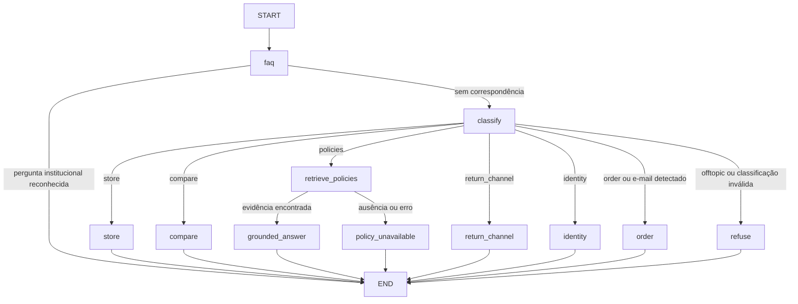
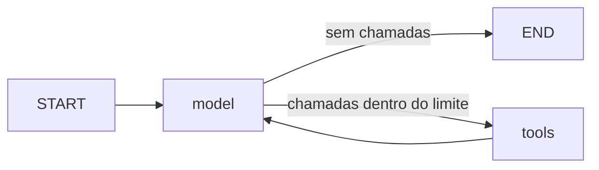

# Orquestração com LangChain e LangGraph

O endpoint `POST /api/chat` executa dois grafos compilados. LangChain fornece o modelo de chat, mensagens e ferramentas com schemas Pydantic. LangGraph controla classificação, encaminhamento e o ciclo de ferramentas. CSVs, busca híbrida, cálculos de preço e verificação de pedidos permanecem funções de domínio em Python.

## Grafo de atendimento

Implementado em `app/assistant.py`, com estado `StoreState` que estende `ConversationContext`.



- **FAQ institucional:** antes da classificação, regras conservadoras reconhecem endereço, horário regular e contatos. Respostas e fontes são derivadas do manual, em cache por hash, sem modelo ou embeddings. Perguntas não reconhecidas seguem para o classificador. [Detalhes](cache-institucional.md).
- **Produtos:** o agente escolhe ferramentas para buscar categorias, produtos, ofertas e canais oficiais. As ferramentas consultam os arquivos atuais; cards são construídos com seus resultados.
- **Comparação:** o grafo consulta os IDs selecionados anteriormente antes da geração, com orçamento e diferenças monetárias calculadas por `Catalog.compare`. Sem duas opções, pede que o cliente as escolha.
- **Informações da loja:** o nó `retrieve_policies` executa a busca híbrida existente antes de gerar a resposta. Consulta inclui pergunta pendente, modalidade conhecida e contexto recente, limitada a 500 caracteres. Evidências e avisos são entregues como mensagem de ferramenta com páginas. Ausência de evidência e erro têm respostas distintas controladas pela aplicação.
- **Devolução:** sem modalidade, pergunta online/presencial. Uma resposta explícita atualiza a modalidade no estado. A pergunta pendente é preservada para a busca do turno seguinte.
- **Pedidos:** a intenção encaminha ao formulário existente. E-mail digitado no chat é interceptado antes da chamada ao classificador. A verificação por número + e-mail é um endpoint determinístico separado.
- **Escopo:** identidade e recusa têm texto controlado pela aplicação; intenção inválida encerra na recusa. A classificação usa o modelo e pode errar. O grafo restringe caminhos e ferramentas, mas não prova a correção de toda interpretação ou resposta.

## Grafo de ferramentas

Implementado em `app/agent_graph.py`, chamado nos caminhos de produtos, comparação e resposta com evidências.



`AgentState` carrega mensagens LangChain, contador de gerações e resposta. Cada turno admite até quatro gerações neste subgrafo e até três chamadas de ferramentas por geração. A classificação é uma chamada adicional. Comparação e políticas podem realizar uma consulta determinística anterior ao subgrafo. Tentativas de ultrapassar os limites geram erro controlado, em vez de continuar o ciclo. Há também limites de recursão nos grafos.

`app/langchain_tools.py` define sete ferramentas LangChain com schemas estritos:

| Ferramenta | Domínio |
|---|---|
| `search_catalog` | Produtos, preço de tabela, estoque e filtros |
| `list_categories` | Categorias disponíveis |
| `compare_products` | Comparação por IDs e diferença para o orçamento |
| `search_promotions` | Ofertas vigentes e cálculo decimal |
| `search_policies` | BM25 + embeddings locais, fontes e avisos |
| `store_contacts` | Canais oficiais extraídos do manual |
| `dismiss_budget_offer` | Recusa de proposta na sessão, preservando o orçamento anterior |

Argumentos extras ou de tipo incorreto produzem resultado `invalid` sem chamar a consulta. Validações de domínio permanecem no Python. Nenhuma ferramenta cria pedidos, altera estoque ou envia mensagens. Dados e credenciais de pedidos não são ferramentas disponíveis ao modelo.

## Modelo e transporte

`app/langchain_model.py` implementa `BaseChatModel`, `bind_tools`, `HumanMessage`, `AIMessage`, `SystemMessage` e `ToolMessage`. O adaptador usa o transporte `app/openrouter.py`, preservando IDs nativos de chamadas e a política existente: somente modelos gratuitos, repetição limitada e nenhuma repetição automática para HTTP 429.

O transporte legado é mantido como fronteira HTTP testada; o antigo loop manual de quatro rodadas foi substituído pelo grafo. A adaptação de mensagens permite reutilizar os testes do transporte. O endpoint continua usando OpenRouter; não foi introduzido outro serviço de inferência.

O limite de 24 KB UTF-8 é verificado antes de cada chamada ao transporte, inclusive na classificação. É um limite de contexto dinâmico serializado, excluindo o prompt de sistema fixo, e não uma contagem exata de tokens. Documentos permanecem como dados em mensagens de ferramenta.

## Memória e interface

`ConversationContext` guarda preferências, IDs recentes, assunto, modalidade, pergunta pendente e ações permitidas. A sessão existente é a fonte de estado entre requisições. O grafo recebe uma cópia por turno e os dados necessários são salvos após sucesso. Não foram configurados checkpoint externo, banco de conversas ou serviço LangSmith.

O contexto expira após 15 minutos, respeita os limites existentes e é apagado por “Nova conversa”. Sessões não compartilham histórico. E-mails são omitidos do histórico reutilizável.

O contrato HTTP continua retornando `message`, `products`, `sources`, `contacts`, `actions` e `conversation_id`, além dos sinalizadores de formulário quando pertinentes. A interface não precisou mudar. Seleção visual de instrumento/orçamento e verificação de pedido continuam sem LLM, inclusive sem cota do provedor.

## Reproduzir a validação

```bash
.venv/bin/pip install -r requirements.txt
.venv/bin/python -m unittest discover -s tests -v
.venv/bin/mypy app --check-untyped-defs
node tests/test_frontend.js
```

Os testes `test_graph_*.py` passam por grafos, mensagens, ferramentas e APIs reais, com geração de modelo simulada. Há cobertura de escopo, argumentos inválidos, fontes, ausência/erro, modalidade, comparação após seleção visual, sessões, expiração, reset, privacidade e limites. Os testes existentes de recuperação continuam verificando o índice com embeddings locais reais.

Para a verificação opcional em Chromium:

```bash
.venv/bin/pip install playwright
.venv/bin/playwright install chromium
PYTHONPATH=. .venv/bin/python tests/browser_graph_smoke.py
```

Esse script inicia um servidor local temporário e exercita interface → HTTP → LangGraph → ferramentas → dados. Apenas a inferência do modelo é simulada; catálogo e recuperação do PDF são reais. Ele não lê nem envia uma chave OpenRouter. O script `tests/browser_smoke.py` continua cobrindo a interface em desktop/celular com o servidor normal iniciado; nesse segundo script, os endpoints de chat e verificação de pedido são simulados.

Nenhum desses testes comprova disponibilidade ou qualidade do modelo gratuito ao vivo. Os exemplos anteriores em `docs/exemplos-de-interacao.md` são históricos e precedem a migração. A imagem Docker também precisa ser reconstruída para incluir as novas dependências; medições anteriores de memória não são um novo benchmark desta versão.

## Explicar na entrevista

LangChain padroniza mensagens, ferramentas e integração do modelo. LangGraph torna explícitos o estado, as transições e o ciclo limitado de ferramentas. As regras determinísticas seguem em funções de domínio. A busca híbrida foi preservada porque migrar a orquestração não exige substituir um mecanismo de recuperação já avaliado.

Referências: [modelos LangChain](https://docs.langchain.com/oss/python/langchain/models), [ferramentas LangChain](https://docs.langchain.com/oss/python/langchain/tools) e [Graph API](https://docs.langchain.com/oss/python/langgraph/graph-api).

## Decisão pendente de orçamento

Quando uma busca guiada não encontra opções dentro do teto, a sessão guarda a categoria e o valor oferecido em `pending_budget`, além do orçamento original. O classificador recebe esse estado e o histórico; o agente também recebe as preferências e a proposta. A LLM interpreta a resposta e escolhe a ferramenta e os filtros, sem listas de frases ou reconhecimento de nomes de instrumentos em Python.

Para aceitar a proposta, o agente chama `search_catalog` com o valor oferecido. Para abandonar o limite, busca sem `min_price`/`max_price`. Cada busca define os filtros completos, substituindo os anteriores somente após uma consulta válida. Para recusar a proposta sem buscar, chama `dismiss_budget_offer`, que limpa a proposta e preserva o orçamento. Consultas simples por categoria usam o mesmo serviço `catalog_reply` da interface para manter cards, resumo e recuperação de orçamento consistentes. Preços, estoque e valores sugeridos continuam sendo calculados e consultados em Python.

Orçamento é opcional; a LLM usa o histórico para identificar o instrumento e não deve repetir uma pergunta recusada. Isso é uma instrução e um contrato de ferramentas, não uma garantia de interpretação perfeita. Testes com inferência simulada verificam o transporte de contexto e a execução de filtros; avaliações com o provedor real verificam se o modelo interpreta variações de linguagem. Reinício e expiração removem o contexto.

Avaliação opcional com o provedor real (envia conversas sintéticas e consome a cota configurada):

```bash
.venv/bin/python scripts/evaluate_budget_language.py --live
```

O script cobre orçamento em aberto com diferentes formulações, aceitação e recusa de uma proposta. Registra as ferramentas escolhidas e verifica categoria, orçamento, produtos reais e estado pendente; não comprova todas as afirmações do texto gerado nem mede disponibilidade geral do provedor.
